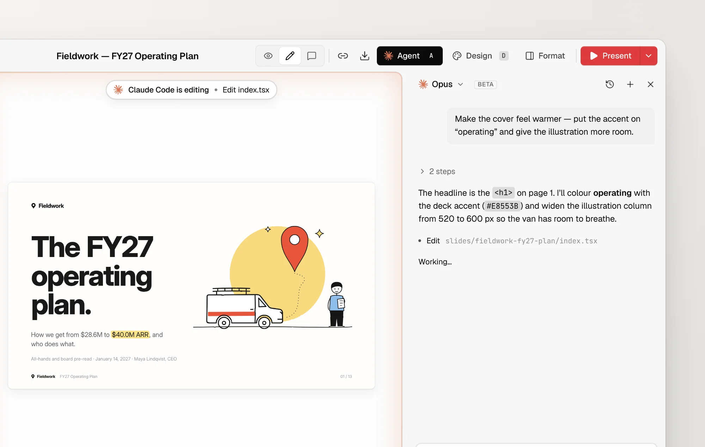
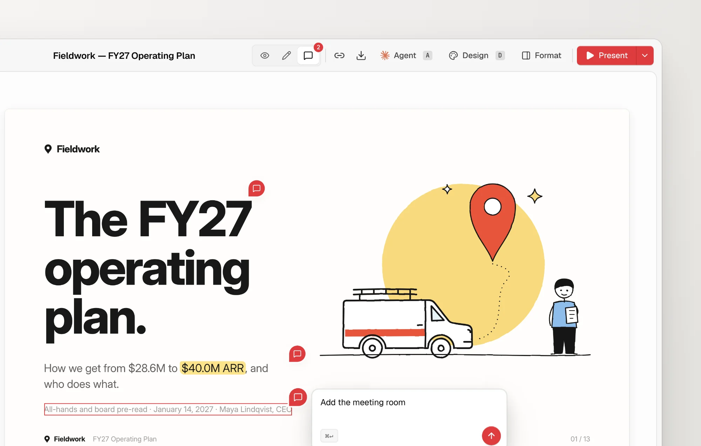
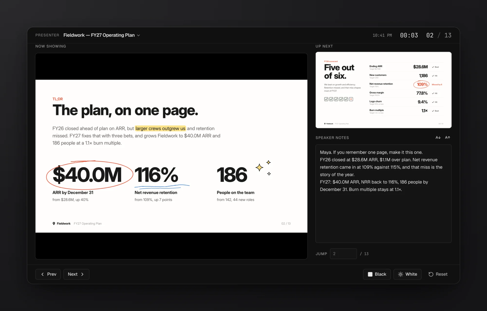

# open-slide

The slide framework built for agents. Describe a deck, and your coding agent writes it as React. open-slide handles the canvas, scaling, navigation, hot reload, editing, and present mode.

Every page is a React component rendered on a fixed 1920 × 1080 canvas.

```bash
npx @open-slide/cli init my-deck
cd my-deck
npm run dev
```

[Documentation](https://open-slide.dev/docs) · [Changelog](https://open-slide.dev/changelog)

## Agent panel

Connect the Claude Code or Codex CLI you already use and drive it from the browser. Press `A` on any slide to open the panel.



- **Draft a deck.** Click New deck on the home page and describe it. The agent writes it page by page while the canvas follows along.
- **Edit what you see.** The current slide, page, and selected element go along with every message, so "make this bigger" just works.
- **Apply comments** with one click from the comment bar.
- **Uses your existing login.** The SDK installs into the workspace the first time you open the panel. No API keys to configure.

Prefer the terminal? The bundled skills (`/create-slide`, `/apply-comments`, `/create-theme`) work with any coding agent, including Claude Code, Codex, Cursor, and others.

## Comment mode

Press `C`, click an element or drag across a region, and leave a note. Notes are saved as `@slide-comment` markers in the source, and the agent applies them all in one pass.



## Present mode

Fullscreen playback with keyboard navigation, and a presenter view with the next slide, speaker notes, and a timer.



## Also included

- Visual editor with drag, resize, alignment guides, and inline text editing
- Themes, page transitions, step-by-step reveals, and shared-element morphs
- Assets manager with brand logo search via [svgl](https://svgl.app) and Google Fonts
- Export to static HTML, PDF, and PPTX
- Static build that deploys to Vercel, Cloudflare Pages, Netlify, or any static host

## Repository

| Path | Description |
| --- | --- |
| [`packages/core`](packages/core) | `@open-slide/core`: runtime, Vite plugin, and the `open-slide` CLI |
| [`packages/cli`](packages/cli) | `@open-slide/cli`: the `init` scaffolder and project template |
| [`apps/demo`](apps/demo) | Local workspace for developing the framework |
| [`apps/web`](apps/web) | Website and docs |

```bash
pnpm install
pnpm dev         # run the demo against local core
pnpm build       # build all packages
pnpm typecheck
pnpm check       # biome
pnpm test
```

See [CONTRIBUTING.md](CONTRIBUTING.md) before opening a pull request.

## Support

<a href="https://vercel.com/open-source-program"></a>

If open-slide is useful to you, consider supporting development:

<a href="https://buymeacoffee.com/1weiho"></a>

## License

MIT © [Yiwei Ho](https://github.com/1weiho)
